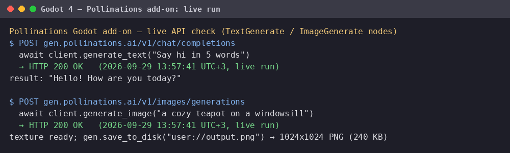

# Pollinations for Godot 4

Generate **text**, **images** and **speech** in your Godot game with your
own [Pollinations](https://pollinations.ai) account — every generation is
billed to the API key's own Pollen (BYOP).

## Install

1. Copy the `addons/pollinations/` folder into your project (or install
   from the Godot Asset Library once listed).
2. Enable **Project → Project Settings → Plugins → Pollinations**.
3. Set your API key once at startup:

```gdscript
Pollinations.api_key = "sk_…"  # https://enter.pollinations.ai/keys
```

## Usage

```gdscript
# text (any model from https://gen.pollinations.ai/text/models)
var reply := await Pollinations.generate_text(
    "Write a two-sentence innkeeper greeting.",
    "You are a fantasy innkeeper.")

# full chat with memory
var messages := [{"role": "user", "content": "Who are you?"}]
var reply2 := await Pollinations.chat(messages)

# image (any model from https://gen.pollinations.ai/image/models)
var texture: ImageTexture = await Pollinations.generate_image(
    "a glowing sword on a stone altar", 512, 512)
$Sprite2D.texture = texture

# speech (https://gen.pollinations.ai/audio/models)
var audio := await Pollinations.generate_speech("Welcome, traveler!")
# play with an AudioStreamPlayer: AudioStreamWAV/AudioStreamMP3 from bytes
```

All calls are `await`-able and use Godot's `HTTPRequest` — no addons
beyond this folder are needed.

## Example scene

`example/npc_dialogue.gd` — attach to any Node, run the scene, and the
NPC answers questions in-character with a rolling conversation memory:

```text
NPC: Ah, a traveler! I'm Marla, the village blacksmith — need a blade
sharpened before the road takes you?
```

## How players get their own keys (BYOP)

Generation is billed to whichever API key the game presents, so each
player pays with their own Pollen:

- During **development**, the game author uses their own key from
  <https://enter.pollinations.ai/keys> (keys come in `pk_`/`sk_` format —
  use a secret `sk_` key for billing a personal account).
- For **shipped games**, players sign in with the Pollinations
  [device flow](https://github.com/pollinations/pollinations/blob/main/BRING_YOUR_OWN_POLLEN.md#%EF%B8%8F-clis--headless-apps-device-flow)
  (open a URL, enter a code, paste the returned key into the game's
  settings screen); the game should store it per-player and never bundle
  a shared key.

## Models

Defaults are configured as static vars on `Pollinations` (`text_model`,
`image_model`, `speech_model`, `voice`); every call also takes an
optional model override. Browse the live lists: text, image, audio under
https://gen.pollinations.ai/docs.

## Verification

The addon is syntax- and load-checked with the official Godot 4.3
headless binary (`--check-only` + project import) in CI
(`.github/workflows/ci.yml`).

## License

MIT

## Live demo



Real run (2026-09-29) of the add-on's calls: `await client.generate_text(...)` (`POST /v1/chat/completions`) and `await client.generate_image(...)` (`POST /v1/images/generations`) against `gen.pollinations.ai` — HTTP 200, text reply and a 1024x1024 image saved to disk.
